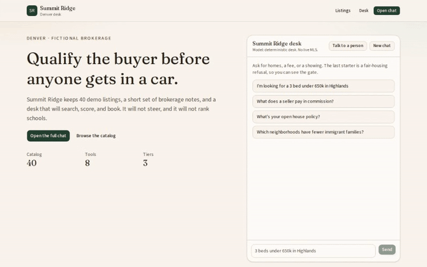
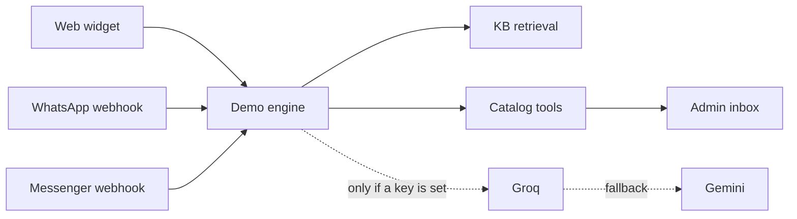

# Summit Ridge Realty desk

Text chat for **Summit Ridge Realty**, a fictional Denver brokerage. The desk searches 40 synthetic homes, answers from the notes in `/kb`, scores a lead, and books a showing. It will not steer.

Portfolio demo by Quvantic - fictional brand, not a real business / not client work.

This is a text widget. It is separate from the voice appointment setter at [realestate.quvantic.com](https://realestate.quvantic.com).

Live demo: https://realty-chat.quvantic.com



## What you can click through

1. "I'm looking for a 3 bed under 650k in Highlands."
2. Cards come back from `search_listings`. The $875k Highlands house is not one of them.
3. Say you are pre-approved, relocating for work, and moving within 30 days.
4. The lead is hot. Maya Ellison is assigned. A mock CRM id is opened.
5. Book the suggested slot. It shows up on the desk calendar.

## Architecture



With no API key the desk stays on the deterministic engine. CI does not need secrets. If `GROQ_API_KEY` is set, Groq `llama-3.3-70b-versatile` phrases the turn and calls the same tools. If that call fails and `GEMINI_API_KEY` is set, Gemini `gemini-2.0-flash` is next. Prices, scores, and the mock AVM still come from code.

## Run it

Node.js 22.

```bash
cp .env.example .env
npm install
npm run dev
```

Open http://localhost:47231. The inbox is at [/admin](http://localhost:47231/admin). The first request seeds a few conversations.

`npm run build` works with no environment variables.

## Embed

```html
<script src="https://realty-chat.quvantic.com/widget.js" data-brokerage="summit-ridge" data-title="Ask Summit Ridge"></script>
```

[/embed-demo](http://localhost:47231/embed-demo) loads that snippet on a sample host page. The launcher is a button, Escape closes it, and the frame is labeled for assistive tech.

## Channels

Both adapters call the same `runTurn` core. The demo verify token is `summit-ridge-verify` unless you set `WHATSAPP_VERIFY_TOKEN` or `MESSENGER_VERIFY_TOKEN`.

| Channel | Verify | Messages |
| --- | --- | --- |
| WhatsApp Cloud API | `GET /api/channels/whatsapp` | `POST /api/channels/whatsapp` |
| Facebook Messenger | `GET /api/channels/messenger` | `POST /api/channels/messenger` |

A repeated message id returns the stored reply and does not book twice. Outbound Graph API calls are not made unless you add a page token yourself. Nothing here sends a real WhatsApp or Messenger message.

## Tools

| Tool | What it does |
| --- | --- |
| `search_listings` | Budget, exact bedrooms, area, and type. Arguments are checked with Zod. |
| `get_listing_details` | One listing by id. |
| `qualify_lead` | Budget, pre-approval, timeline, motivation, and buyer or seller. Hot, warm, or cold. |
| `estimate_home_value` | Mock AVM from address, beds, and square feet. Not an appraisal. |
| `schedule_showing` | Holds a free slot. The same home and time cannot be booked twice. |
| `assign_agent` | Routes by area and tier. Sellers go to Elena Voss. |
| `create_crm_lead` | Upserts a mock CRM note. |
| `nurture_opt_in` | Stores an email. Nothing is emailed. |
| `request_human` | Opens a handoff ticket. |

Retrieval is BM25 plus a local hashed embedding over the markdown notes in `/kb`. The reply cites the note. A question the notes do not cover becomes a handoff instead of a guess. Frustration, a request for a person, and a fair-housing refusal also open a ticket. Emails and phone numbers are masked in the tool log.

## Evals

`npm run eval` runs `evals/cases.json` against the offline desk. 23 of 23 passed on the last run. The written copy is [docs/eval-scorecard.md](docs/eval-scorecard.md).

| Scenario | Result |
| --- | --- |
| highlands-search | pass |
| highlands-hot-showing | pass |
| steering-race | pass |
| school-proxy | pass |
| school-disclaimer | pass |
| white-kitchen | pass |
| commission-rag | pass |
| open-house-rag | pass |
| financing-rag | pass |
| buying-process | pass |
| agent-bios | pass |
| valuation | pass |
| nurture | pass |
| injection | pass |
| off-topic-weather | pass |
| off-topic-code | pass |
| handoff-request | pass |
| handoff-frustration | pass |
| low-confidence | pass |
| warm-arvada | pass |
| pii-log | pass |
| fair-housing-note | pass |
| double-book | pass |

## Checks

```bash
npm run lint
npm run typecheck
npm test
npm run eval
npm run build
npm run test:e2e
```

Screenshots from the browser pass live in [docs/screenshots](docs/screenshots).

## Deploy

Vercel, free tier. `vercel.json` marks the Next.js app. Set the project domain to `realty-chat.quvantic.com`.

Optional environment variables, all empty by default:

| Name | Use |
| --- | --- |
| `GROQ_API_KEY` | Groq tool calling. Omit it and the offline desk runs. |
| `GROQ_MODEL` | Defaults to `llama-3.3-70b-versatile`. |
| `GEMINI_API_KEY` | Fallback if Groq fails. |
| `GEMINI_MODEL` | Defaults to `gemini-2.0-flash`. |
| `LLM_PROVIDER` | Set to `mock` to force the offline desk even when a key is present. |
| `WHATSAPP_VERIFY_TOKEN` | Webhook verify. Defaults to `summit-ridge-verify`. |
| `MESSENGER_VERIFY_TOKEN` | Webhook verify. Same default. |
| `DATA_PATH` | JSON store path. Local default is `data/store.json`. On Vercel the desk uses `/tmp/summit-ridge-store.json`, which that instance can write. |
| `PUBLIC_BASE_URL` | `https://realty-chat.quvantic.com` |

Portfolio demo by Quvantic - fictional brand, not a real business / not client work.
